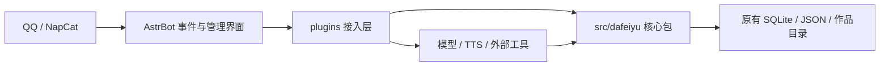

# 大肥鱼独立核心与 AstrBot 接入

2026-11-06。本次为源码重构，基于 `codex/semantic-dialogue` 的 `c5b38fa` 开发；该版本已通过 PR #2 合入 `codex/evening-diary-balance`，因此本次 PR 以该分支的 `6a90b43` 为合并基线。保留自主打算、长期成长和按需自身资料等已有功能，没有部署服务器，没有替换运行配置或数据库。

## 结构

```text
src/dafeiyu/                  独立 Python 包；不导入 AstrBot 或插件目录
  dialogue/                   对话协议、证据核验、检索、学习、成长
  memory/                     事实、偏好、往来片段、图片收藏、人格资料
  life/                       活动账本、打算、项目、反思、世界设定
  initiative/                 主动联系选择、事实核对、持久排程
  balance/                    余额状态机、通知轮次、通知上下文
  social/                     关系与许可、有效对话统计、公开话题
  runtime/                    连发合并、发送记录、数值诊断
  routing/                    私聊历史核对与语音意图
  limits/                     回复额度
  media/{drawing,singing,voice}/  媒体意图、作品记录、生成客户端
  ports.py                    文本提供商、核对回调的结构接口
  compat.py                   旧辅助模块导入的兼容桥接
plugins/                      AstrBot 插件入口、事件钩子、工具、运行时适配
framework/                    原有 AstrBot 4.29.1 源码
persona/                      可导入的人格文本
scripts/                      安装、隔离验证
tests/                        核心独立性与原生插件行为回归
```



核心包承载规则、存储实现及显式调用的媒体客户端，并不等同于全部无 I/O 的纯函数。模块导入不会注册插件、启动任务或读取生产数据。调用方提供事件资料、数据路径、模型提供商或回调；AstrBot 事件注册、服务查询、生命周期与发送仍由接入层负责。QQ 消息语义保留，不承诺已经抽象成通用多平台机器人。

## 依赖约束

- 新业务代码从 `dafeiyu.*` 导入，不从 `data.plugins.*` 反向导入。核心目录禁止任何层级的 AstrBot 或插件导入；测试同时检查函数内的隐藏导入及真实独立加载。
- 插件之间需要实际运行实例时仍通过 AstrBot 注册表查找，保留停用、未配置等判断。框架专用的提供商适配、发送观察器、消息组件转换留在插件层。
- `TextProvider` 只约定异步 `text_chat` 返回带 `completion_text` 的结果，核心测试直接注入假提供商。没有为了重构增加模型调用、外部请求或后台线程。
- 数据库文件名、表结构、会话归属、权限、去重及未知结果处理沿用原实现。安装工具只读源码并复制代码，不访问运行数据。
- 框架和第三方插件保持原位置与许可证。QQ 空间原有的未提交可靠性修改保留，本次不改写这些文件。

## 统一对话入口

`plugins/dafeiyu_dialogue/main.py` 保留 Star 类、注册装饰器、事件优先级、工具名称和状态接口，入口由 1066 行缩为 658 行。未装饰的编排方法按职责拆为：

| 文件 | 责任 |
|---|---|
| `growth_lifecycle.py` | 成长资料同步、评估和后台循环 |
| `evidence_context.py` | 自身活动资料、提供商调用及发送前证据复核 |
| `generation_workflow.py` | 结构化生成收尾、学习校验及遗忘编排 |

三个支持类不继承 Star、不注册事件，只有 `main.py` 注册原有插件。它们属于 AstrBot 接入层，规则解析与存储实现从独立核心调用。

## 旧路径兼容

58 个原辅助模块保留小型导入桥接。普通旧导入与 `dafeiyu.*` 指向同一个模块对象，避免同时存在两份 ContextVar、缓存、类型定义或猴子补丁状态。兼容桥接不保留第二份业务实现。`LifeStore` 另行从原活动引擎中拆出；旧 `life.py` 继续导出它。

这些桥接用于现有第三方插件、测试和外部调用的过渡。新功能应直接使用独立核心。旧插件文件的存在不代表能够单独复制一个插件上线：本次起必须同时提供匹配的核心包。

人格与世界设定 JSON 随核心包分发，分别在 `memory/self_profile.json` 和 `life/world_profile.json`。`persona/live.md` 仍是独立的人格导入材料。真实身份映射在私有安装副本内同时作用于核心和插件，源码保留示例身份。

## 开发与验证

继续使用已有的 Python 3.12 环境及框架、插件依赖。核心打包描述在根目录 `pyproject.toml`，媒体客户端使用现有的 aiohttp、Pillow 和 yarl。

```powershell
# 不把 framework 放入 Python 搜索路径的独立核心验证
python scripts/run_tests.py --core

# 自动发现全部 test_*.py，每个测试文件单独进程、临时数据目录
python scripts/run_tests.py

# 修改一个功能时指定相关文件
python scripts/run_tests.py test_semantic_dialogue.py test_personality_growth.py
```

测试入口自动加入 `src`，无需为了跑测试先安装核心。若其他开发工具需要直接导入，可以在独立开发环境安装本项目；直接运行旧测试文件则需要已安装核心或设置 `PYTHONPATH=src`。运行完整入口不会发送真实 QQ、发布空间或调用付费模型。

提交前在 Windows / Python 3.12.14 下，从暂存区导出本次 PR 的干净源码快照，实测 **23 组、378 项全部通过**，其中独立核心检查 9 项。此前开发工作区通过 24 组、387 项，额外 9 项为空间可靠性测试，连同原有空间修改保留在本地，未纳入本次提交。离线构建 wheel、在临时目录安装及包内 JSON 资源读取也通过；原有 6 个未提交文件的 SHA-256 保持一致。数值见 [验证记录](core-architecture-verification.json)。

默认入口已纳入此前未列入默认清单的自主打算、执行时机和话题变化测试。`--core` 覆盖无框架加载、旧路径身份一致、全新安装、资源加载、身份渲染、拒绝覆盖及未知活动不重做。

重构前实测的三处旧测试差异也已处理，业务实现未因此改写：二次修订用例补齐现有“修订—核对—再修订—再核对”四次假响应；项目提示断言补上现有 `self_direction`；夜间用例检查普通调度，暂停仍检查显式活动机会。带打算的自选执行时间由独立执行测试覆盖。

## 新安装、升级与回滚

在独立运行目录先安装 AstrBot 和所需插件依赖，再执行：

```powershell
python scripts/install_plugins.py --target C:/runtime/AstrBot/data/plugins --identities C:/private/identities.json
```

将得到 `C:/runtime/AstrBot/dafeiyu/` 与 `C:/runtime/AstrBot/data/plugins/`。从该 AstrBot 根目录启动，使核心包能被 Python 找到。自定义布局可以显式传入 `--core-target <Python搜索路径目录>/dafeiyu`；它必须在插件发现目录之外。禁止复制到本仓库内部，已存在的核心或插件目录会在预检查时拒绝；复制期间发生 I/O 故障时保留新建副本供检查，不自动删除或覆盖既有安装。

升级须先在新目录生成并核对整套代码，保留线上后续改动、定制的人格/世界资料及真实配置，再按部署流程停后台任务、备份和切换。**核心更新需要重启 AstrBot 进程，不能只依靠单插件热重载**，因为多个插件共用已导入的核心模块。

回滚代码时恢复同一份旧核心与插件组合并重启；回退到重构前版本时恢复原插件源码。保留最新数据库、通知账本、排程、作品和配置，不用旧数据覆盖新数据，也不重置已经发送或结果未知的任务。历史数据迁移边界继续见 [MIGRATION.md](MIGRATION.md)。
