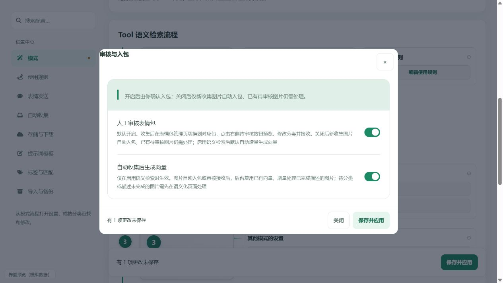
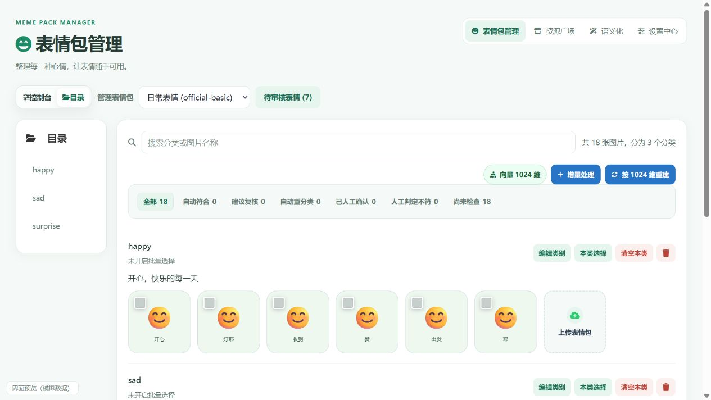

# Automatic collection and vector updates

Choose **Tool semantic search** or **Auxiliary-model semantic search** in Settings, then open **Automatic collection → Review and import**. The new **Generate vectors after collection** setting is enabled by default. It appears and takes effect only when semantic search is enabled. Save and apply configuration changes. In AstrBot’s native plugin configuration, the same switch is under Semantic search and semantic processing, with the same visibility rule.

After automatic import or manual acceptance, the plugin batches images accepted close together and updates the index in the background. Compatible vectors are reused; only new or changed semantic content requires embedding requests. These requests use the configured embedding provider and may incur charges. Images awaiting acceptance are not embedded.

Incremental processing accepts images whose descriptions are complete. Images awaiting classification, incomplete descriptions, or descriptions invalidated by a category change must first be processed on the Semantic page. Pending images do not block searches against existing valid vectors. Stale vectors for changed semantic content, deleted images, or replaced files are excluded from results, and valid alternatives are fetched.

| Previous entry point | Current entry point and purpose |
| --- | --- |
| Pack management → Rebuild with current dimension | Preserved as a full rebuild; use after changing the model or dimension |
| Rebuilding after routine image additions | Pack management → Incremental processing; reuse existing vectors and process new or changed content |
| Semantic → Advanced maintenance → Build or rebuild index | Preserved; compatible indexes are updated incrementally |

If automatic generation is disabled, use Incremental processing manually. Without an existing index, all images with complete descriptions need embedding. If an existing index uses a different provider, model, or dimension, incremental processing requests a full rebuild instead. Failed vector tasks retain images and saved descriptions; fix the provider and retry manually. Busy packs retain pending automatic updates and retry when resources become available. Paused or interrupted semantic queues must first be resumed to completion or cleared; incremental updates preserve those queues. With manual review disabled, only newly collected candidates deferred by a busy pack are retried automatically; older manual-review candidates remain untouched. Damaged indexes, missing manifests, or unreadable unchanged vectors require an explicit full rebuild rather than silently embedding the entire library. The management page periodically refreshes the current pack’s vector status.
